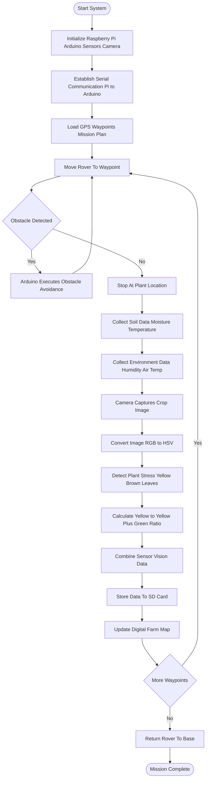

# 🌱 Autonomous Farm Rover

A low-cost autonomous rover for soil monitoring, crop health analysis, and field data collection. Built on Raspberry Pi 4 + Arduino Nano. 

## Field use

The rover has been **field-tested on 15 farms**, providing practical soil and
crop data. It records soil moisture and temperature, environmental readings,
GPS positions, and OpenCV color-based crop-stress indicators through its
local dashboard and CSV/SQLite logs.

---

## Project Structure

```
rover/
├── venv/                       
├── arduino/
│   ├── rover_firmware/
│   │   └── rover_firmware.ino   ← Flash to Arduino Nano
│   ├── rover_simulator.py       ← Simulates Arduino (no hardware needed)
│   └── test_firmware.py         ← Firmware protocol tests
├── pi/
│   ├── config.py                ← All settings (ports, speeds, thresholds)
│   ├── mission.py               ← Run this on the Pi to start patrol
│   ├── comms/serial_handler.py  ← Arduino serial interface
│   ├── sensors/data_logger.py   ← CSV + SQLite data logging
│   ├── navigation/
│   │   ├── gps_reader.py        ← NEO-6M GPS parsing
│   │   ├── imu_reader.py        ← MPU-6050 heading
│   │   └── waypoint_nav.py      ← Patrol mission logic
│   ├── vision/crop_health.py    ← OpenCV crop stress detection
│   └── dashboard/server.py      ← Flask local web dashboard
├── tests/                       ← Full test suite
├── data/
│   ├── logs/                    ← CSV session logs (auto-created)
│   ├── db/rover.db              ← SQLite database (auto-created)
│   └── images/                  ← Crop photos (auto-created)
└── requirements.txt
```

---

## Setup

```bash
# 1. Activate venv
source venv/bin/activate

# 2. Install dependencies
pip install -r requirements.txt

# 3. On Raspberry Pi only (hardware-specific libs)
sudo apt install python3-picamera2
pip install smbus2 pyserial
```

---

## Running

### Simulation mode (no hardware — for development)
```bash
cd rover
source venv/bin/activate
python -m pi.mission --simulate
```

### Real hardware (on the Pi)
```bash
python -m pi.mission
```

Startup puts the rover in standby. Use `/mission` to save waypoints and press
**Start Mission** when ready; autonomous patrol starts on that operator action.
Manual drive is available at `/control`.

### Arduino
1. Open `arduino/rover_firmware/rover_firmware.ino` in Arduino IDE
2. Install libraries: `ArduinoJson`, `DallasTemperature`, `Adafruit BME280`
3. Flash to Arduino Nano

### Tests
```bash
python arduino/test_firmware.py
pytest tests/
```

---

## Dashboard

Once the mission is running, open a browser on any device on the same network:
```
http://<raspberry-pi-ip>:5000
```
No internet required.

---

## Waypoints

Plan and save the farm's GPS waypoints in the `/mission` dashboard. They are
stored in `data/waypoints.json` and loaded by `build_waypoints()` in
`pi/mission.py`. No route is pre-populated at startup. Measure the farm
coordinates by walking the corners with a phone GPS app.

---

## Hardware BOM

See `FarmRover_BOM.xlsx` for the full 27-item bill of materials .

---

## Flowchart Design



